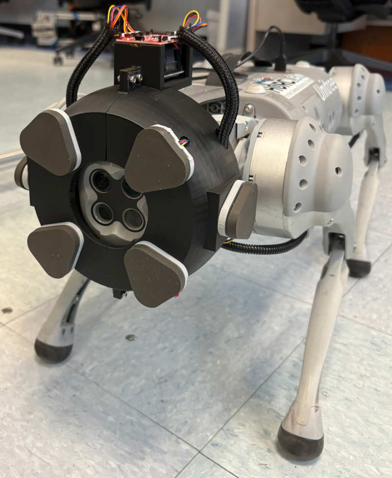
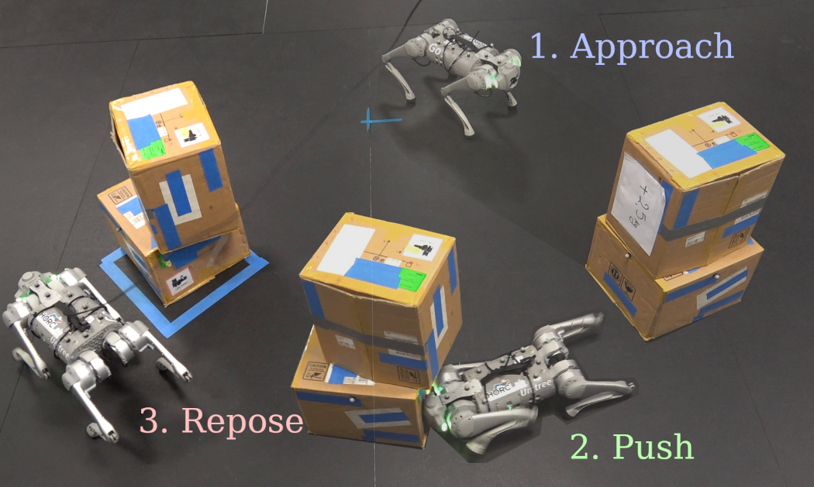

## Project Goal
This project develops tactile sensing and learning-based whole-body control that let quadruped robots use their bodies to perceive, push, and manipulate objects in unstructured environments.

---

## Key Contributions
* <strong style="color: #F97316;">Sensorized Head for Physical Interaction:</strong> Developed Head-On, a helmet for the Unitree Go1 with four soft magnetometer-based tactile sensors in an optimized layout. It turns the robot’s head into a contact surface that can measure 3D interaction forces while pushing and manipulating objects.
* <strong style="color: #F97316;">Drift-Robust Tactile Force Estimation:</strong> Built a learning-based calibration pipeline that works on a moving, floating-base robot. A causal 1D CNN detects contact and resets the sensor baseline to cancel drift, and an LSTM-MLP network maps the magnetic readings to 3D forces with minimum error.
* <strong style="color: #F97316;">Whole-Body Manipulation of Object Stacks:</strong> Introduced SOMA, a hierarchical reinforcement learning framework in which the robot adjusts its body height to push multi-object stacks in 3D without the top layers sliding or tipping. It reached up to 90% success in simulation and transferred zero-shot to the real Go1.

---

## Media & Experimental Demos

<!-- 1-Column Media Layout -->

  <!-- YouTube Embed 1 -->
  

    <iframe src="https://www.youtube.com/embed/hryuHfYyxQs?si=tHSwUitiXljucjU2" style="position: absolute; top:0; left:0; width:100%; height:100%; border:0;" allowfullscreen></iframe>
  

  <!-- YouTube Embed 2 -->
  

    <iframe src="https://www.youtube.com/embed/zm-xnCMI1uE?si=p-V8bLsfMT5cao8c" style="position: absolute; top:0; left:0; width:100%; height:100%; border:0;" allowfullscreen></iframe>
  

<!-- Image Gallery Container -->

  
  

---

## Selected Publications  
(see [Publications](/publication/) for a complete list)

* **Head-On: Robust Tactile Force Sensing for Quadrupedal Interaction**  
  Stergios Bachoumas, John Cahill and Panagiotis Artemiadis
  *2026 IEEE/RSJ International Conference on Intelligent Robots and Systems*, 2026.
  [[PDF](/papers/bachoumas2026headon.pdf)]

---

## Funding & Acknowledgments
This work has been supported by the following grants:
